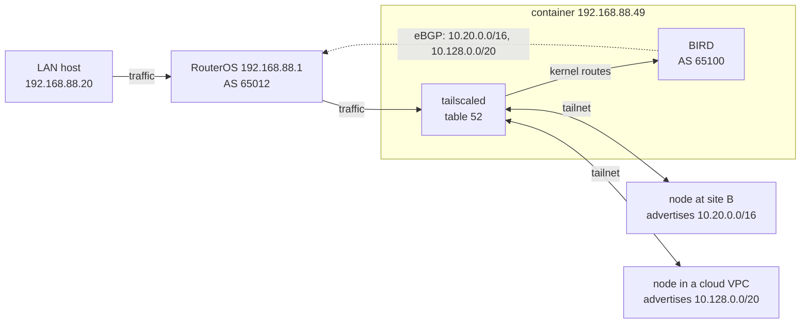

# routeros-tailscale-bgp

Tailscale in a RouterOS container, with BIRD alongside it announcing the
tailnet's subnet routes to the router over eBGP.

The usual MikroTik Tailscale container makes the router a subnet router: your
LAN becomes reachable from the tailnet. The reverse direction is the awkward
part. Subnets advertised by *other* nodes (another site, a cloud VPC, a lab)
are accepted with `--accept-routes`, but tailscaled installs them in its own
routing table 52 inside the container, and RouterOS never sees them. You end
up with a static route on the router for every remote subnet, maintained by
hand.

This image adds BIRD, which reads table 52 and announces those prefixes to
RouterOS. Approve a subnet route in the Tailscale admin console and it shows
up in `/ip/route` about ten seconds later. Every host on the LAN can reach it
without running a Tailscale client.



Each remote node advertises its own subnet. The container accepts both, BIRD
announces both, and RouterOS installs them with the container (192.168.88.49)
as the gateway.

## Contents

| Path | What it is |
|---|---|
| `build.py` | Builds the image without Docker (Python 3 standard library only). |
| `tailscale.sh` | Container entrypoint: upstream script plus the additions marked `Local change`. |
| `routeros/setup.rsc` | First-time setup: veth, env, mount, container, BGP, filters, NAT. |
| `routeros/upgrade.rsc` | Swaps the running container for a newly built image. |

## Requirements

- RouterOS 7 with the `container` package and `/system/device-mode` set to
  `container=yes` (confirmed with a cold reboot or the mode button). Tested on
  7.23–7.25.
- arm64 (RB5009, CCR2004/2116, hAP ax², hAP ax³, Chateau ax, L009) or amd64
  (CHR, x86). 32-bit ARM (RB4011, hAP ac²) would need an armv7 variant in
  `build.py`. MIPS models can't run containers at all.
- External storage for the image and container root (USB or NVMe). Don't put
  them on the internal flash.
- About 95 MB of disk and around 100 MB of RAM while running.

## Building the image

```sh
python3 build.py                      # arm64, latest stable Tailscale, Alpine 3.24
python3 build.py --arch amd64         # CHR / x86
python3 build.py --tailscale 1.104.2  # pin a version
```

The script downloads an Alpine minirootfs, the `iptables ip6tables
iproute2-minimal bird2` packages with their dependencies (resolved from
APKINDEX), and the official static Tailscale binaries. It writes a legacy
`docker save` tar with uncompressed layers, which is the form
`/container/add file=` accepts. Downloads are cached in `.cache/`.

## Installing

Copy the image to the router and run the setup script:

```sh
scp tailscale-arm64.tar routeros/setup.rsc admin@192.168.88.1:usb1/
```

Edit the variables at the top of `setup.rsc` first (LAN prefix, router and
container addresses, AS numbers, disk name). Then on the router:

```routeros
/import usb1/setup.rsc
```

On first start, the container log (`/log/print where topics~"container"`)
prints a login URL. Open it, then approve the advertised LAN route in the
admin console. To skip the interactive login, add a pre-auth key as
`AUTH_KEY` to the `tailscale` env list before starting.

The script adds:

- `veth-tailscale` with the container address, as a port of the LAN bridge
- env list `tailscale`, mount `tailscale_state` (the node key lives there, so
  recreating the container does not log it out)
- a route `100.64.0.0/10` via the container, for the tailnet node addresses
- BGP connection `tailscale-container` with filters `tailscale-in` and
  `tailscale-out`
- a forward drop for routed traffic from the container back into the LAN
  bridge (loop guard, see below)
- dstnat and port-preserving srcnat for UDP 41641, so peers can connect
  directly instead of through DERP

Everything carries the comment `tailscale-bgp`.

## Environment variables

| Key | Default | Meaning |
|---|---|---|
| `TAILSCALE_ARGS` | | Passed to `tailscale up`. Use at least `--accept-routes=true --netfilter-mode=off`. |
| `ADVERTISE_ROUTES` | | Subnets this node advertises, comma separated. |
| `TAILSCALED_ARGS` | | Passed to `tailscaled`, e.g. `--port=41641`. |
| `TAILSCALE_SET_ARGS` | | Passed to `tailscale set` after every `up --reset`, for settings `up` does not take (peer relay: `--relay-server-port=40000`). |
| `AUTH_KEY` | | Pre-auth key for unattended login. |
| `LOGIN_SERVER` | Tailscale | Control server URL, e.g. a Headscale server. |
| `BGP_PEER` | | Router address. BIRD starts only if this is set. |
| `BGP_PEER_AS` | | Router AS. |
| `BGP_LOCAL_AS` | `65100` | Container AS. |
| `MAIN_TABLE_PREFIXES` | | Prefixes the router reaches some other way (WireGuard, IPsec). Inside the container they use the main table, not tailnet routes. |
| `MASQUERADE_TAILNET` | `1` | Masquerade traffic leaving through `tailscale0` to the node's 100.x address. |
| `SNAT_SUBNET_ROUTES` | `1` | SNAT tailnet clients reaching the advertised subnets, so replies come back through the container. |
| `CLAMP_MSS_TAILNET` | `1` | Clamp TCP MSS on SYNs leaving through `tailscale0` to the path MTU (1240). |

## Choosing what to accept

`tailscale-in` is where you decide which tailnet routes the router uses. The
setup script rejects:

- `0.0.0.0/0`, which a node offering itself as an exit node advertises
- `100.64.0.0/10`, the tailnet itself, already routed statically
- your own LAN prefix

Add a reject for any prefix the router already reaches another way. Don't rely
on `distance` to make another BGP route win: among BGP paths, RouterOS applies
BGP best-path selection before distance. If the same prefix arrives from two
BGP peers, filter it out on the one you don't want.

BIRD sends IPv4 only. Tailnet node addresses (`100.64.0.0/10`) and
`100.100.100.100` are never exported.

## Upgrading

```sh
python3 build.py
scp tailscale-arm64.tar routeros/upgrade.rsc admin@192.168.88.1:usb1/
```
```routeros
/import usb1/upgrade.rsc
```

The tailnet routes are gone for the minute or so it takes. If you manage the
router through the tailnet, keep another way in.

## Troubleshooting

```routeros
/log/print where topics~"container"
/container/shell tailscale cmd="tailscale status"
/container/shell tailscale cmd="ip route show table 52"
/routing/bgp/session/print
/ip/route/print where bgp
```

**Small responses work, larger ones hang.** The TCP handshake completes, then
the first full-size segment from the server never arrives. The tailnet MTU is
1280. The remote subnet router sends ICMP "fragmentation needed" towards the
server, but some networks drop it, so the server keeps resending the same large
segment. `CLAMP_MSS_TAILNET` (on by default) fixes this for every LAN host at
once without changing any MTU.

**Replies disappear for a prefix you also reach over another tunnel.** With
`--accept-routes`, a prefix advertised by any tailnet node wins inside the
container, so replies leave through `tailscale0` and are dropped by
reverse-path filtering. Put the prefix in `MAIN_TABLE_PREFIXES` and reject it
in `tailscale-in`.

**Why the hairpin drop rule.** If a tailnet peer's public endpoint falls inside
a prefix that BGP points at the container, the container's own WireGuard
packets would go to the router and straight back to the container. The rule
drops routed traffic from the container that would re-enter the LAN bridge.
The container's normal traffic to LAN hosts is bridged, not routed, so the rule
doesn't affect it.

**`--netfilter-mode=off` is deliberate.** tailscaled's own iptables management
doesn't work well in RouterOS containers. Turning it off also turns off its
subnet SNAT and MSS clamping, which is why the entrypoint adds both back.

**LAN hosts send traffic straight to the container.** RouterOS sends ICMP
redirects by default, so after the first packet a host may use 192.168.88.49
directly for those prefixes. That is harmless. To keep everything going
through the router, set `/ip/settings/set send-redirects=no`.

**Advertise each subnet from one node.** If two nodes advertise the same
prefix and BGP is added on top, you get loops that are hard to diagnose.

## Credits

- [Fluent-Networks/tailscale-mikrotik](https://github.com/Fluent-Networks/tailscale-mikrotik):
  the original entrypoint, BSD 3-Clause.
- [wojtekerbetowski/tailscale-mikrotik](https://github.com/wojtekerbetowski/tailscale-mikrotik):
  the image layout this build reproduces.
- [BIRD](https://bird.network.cz/) and [Tailscale](https://tailscale.com/kb/1019/subnets).

## License

BSD 3-Clause, see [LICENSE](LICENSE).
